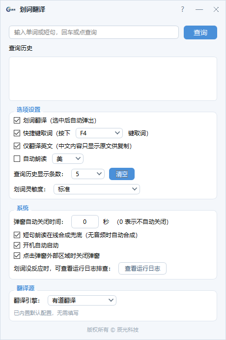

# 划词翻译 · Chenguang Translate

> 一款轻量、无广告的 Windows 桌面划词翻译工具。选中即译，随叫随到。

基于 **Python 3.13 + PyQt6** 开发，采用 PyInstaller `onedir` 打包，开箱即用。
支持**双击单词**、**拖选短句**、**快捷键取词**三种方式，翻译结果以浮动卡片形式显示在鼠标位置附近，不打断当前工作。



---

## 一、功能特性

### 取词方式
| 方式 | 说明 |
| --- | --- |
| **双击单词** | 在任意应用中双击英文单词即可翻译（按系统双击时间判定） |
| **拖选短句** | 按住左键拖选一段文本，松开即触发翻译 |
| **Shift + 点击** | 用于扩展选区的场景（鼠标不位移但选区已变化） |
| **快捷键取词** | 需先在选中文本后再按快捷键，支持 `F4` / `F9` / `Ctrl` / `Alt` / `Ctrl+Shift+T` |

### 翻译浮窗
- **单词视图**：英式 / 美式音标、发音按钮（可点击试听）、基本翻译、网络释义
- **短句视图**：整句译文 + 整句朗读（英音 / 美音）
- **网址识别**：选中链接时不翻译，直接显示原文，并提供「复制」与「在浏览器中打开」
- **中文内容**：按「仅英文划译」开关决定是否翻译，但**一定会弹窗**，方便复制
- **右击菜单**：浮窗内支持右键复制文本
- **不抢焦点**：浮窗出现后你仍可继续输入或按 `Ctrl+C`，不打断操作

### 朗读
- 单词支持**英音 / 美音**双口音试听
- 句子支持整句朗读，某一口音缺失时自动使用另一个口音
- 可勾选**自动朗读**，取词成功后自动发音（英文，长度上限 120 字符）
- 在线发音无录音时，使用语音合成兜底

### 其他
- **内置「使用帮助」**：主界面右上角「?」按钮或托盘菜单即可打开
- **查询历史**：保存最近若干条查询记录（可设置条数或关闭存储）
- **主界面手动查词**：不划词也能输入单词 / 短句查询
- **开机自动启动**（写入注册表 `HKCU\...\Run`）
- **单实例运行**：重复启动会唤起已有窗口，不会重复占用托盘
- **系统托盘常驻**：关闭设置窗口不退出程序，再次运行 exe 可唤回窗口
- **高分屏适配**：支持 Windows 显示缩放（物理像素 → 逻辑像素换算）
- **多翻译源**：有道、百度、谷歌、DeepL 可切换

---

## 二、下载与使用（免安装）

1. 到 [Releases](../../releases) 页面下载最新的 `划词翻译-vX.Y.Z.zip`
2. **完整解压**到任意文件夹（例如 `D:\Tools\划词翻译`）
3. 双击运行 `划词翻译.exe`

> ⚠️ **注意**
> - 必须解压后使用，**不要直接运行压缩包内的 exe**；也不要只复制 exe 到别处。
> - exe 依赖同目录下的 `_internal` 文件夹（内含 Qt 与 Python 运行环境），缺一不可。
> - 首次运行可能被 Windows SmartScreen 拦截，选择「更多信息 → 仍要运行」即可。

启动后会自动打开设置界面；关闭界面后程序仍在**系统托盘**后台运行，随时可用。

---

## 三、使用说明

### 关闭浮窗
- 点击浮窗**外部**任意区域
- 按 `Esc` 键
- 浮窗失焦时自动关闭
- 可选「N 秒后自动关闭」（默认关闭，即不自动关）

### 系统托盘
| 操作 | 行为 |
| --- | --- |
| **单击（或双击）**托盘图标 | 打开设置界面 |
| **右键**托盘图标 | 「打开设置」/「使用帮助」/「退出」 |

### 设置界面
- **查询框**：输入单词或短句后回车查询
- **查询历史**：点击历史条目可直接重新查询，可清空
- **选项设置**：划词翻译开关、快捷键取词开关与按键、**划词灵敏度**、自动朗读与口音、**仅英文划译**、开机自动启动、查询历史条数
- **翻译源**：切换翻译引擎并填写对应凭据，可「测试连接」即时验证

### 划词灵敏度（重要）
调节拖动触发所需的鼠标位移阈值，解决两种常见问题：

| 档位 | 位移阈值 | 适用场景 |
| --- | --- | --- |
| 极宽松 | 1 px | 几乎不动也会触发 |
| 宽松 | 2 px | 轻微拖动即触发 |
| 标准 | 4 px | 默认 |
| 严格 | 10 px | 明显拖动才触发，避免误触 |

> 若发现「划词没反应」，请调为「极宽松」或「宽松」；
> 若单击空白处也弹窗，请调为「严格」。

---

## 四、翻译源配置

默认使用**有道翻译**。出于安全考虑，**源码中不内置任何真实凭据**，请自行配置。有道凭据与其它翻译源**统一存放在同一个文件**：程序目录下的 `config.json`。

| 优先级 | 方式 | 说明 |
| --- | --- | --- |
| 1 | **设置界面填写** | 设置 →「翻译源」→ 选择「有道翻译」→ 填写 appKey / appSecret（推荐） |
| 2 | **直接编辑配置文件** | 程序目录下 `config.json` 中的 `youdao_app_key` / `youdao_app_secret` |
| 3 | **环境变量** | `YOUDAO_APP_KEY` / `YOUDAO_APP_SECRET`（优先级最高，便于临时覆盖） |

打包版运行后会自动在 exe 所在目录生成 `config.json`（例如 `dist\划词翻译\config.json`），有道与其它引擎的凭据都在这个文件里：

```json
{
  "translate_source": "youdao",
  "youdao_app_key": "你的appKey",
  "youdao_app_secret": "你的appSecret",
  "baidu_appid": "",
  "baidu_secret": "",
  "google_apikey": "",
  "deepl_authkey": ""
}
```

> 🔑 密钥获取：到 [有道智云](https://ai.youdao.com) 注册并创建「文本翻译」应用。
>
> ⚠️ **安全提醒**：`config.json` 已被 `.gitignore` 忽略，请勿将你的凭据提交到公开仓库。若密钥不慎泄露，请立即到有道后台轮换。

如需更换翻译源：

| 翻译源 | 需要填写的凭据 |
| --- | --- |
| 有道（默认） | appKey + appSecret（按上表任一方式配置） |
| 百度翻译 | APP ID + 密钥 |
| 谷歌翻译 | Google Cloud Translation API Key |
| DeepL | Authentication Key（可选免费版 / 专业版） |

在设置界面「翻译源」区域切换并填写，填写后可点「测试连接」验证。
这些凭据保存在程序目录下的 `config.json`（**该文件不随版本库分发**）。

> 💡 若凭据为空或网络不通，软件启动时会弹窗提示，翻译失败也会在浮窗里显示具体原因。

---

## 五、从源码运行

```bat
pip install -r requirements.txt
python main.py
```

依赖清单：

| 依赖 | 用途 |
| --- | --- |
| `PyQt6` | 图形界面 |
| `pynput` | 鼠标 / 键盘监听 |
| `keyboard` | 全局热键 |
| `requests` | 翻译接口请求 |
| `pyperclip` | 剪贴板读写（取词） |
| `edge-tts` | 语音合成兜底 |

### 打包为 exe

```bat
build.bat
```

或手动执行：

```bat
pyinstaller 划词翻译.spec -y
```

产物位于 `dist\划词翻译\`。开机自启动注册表项会自动指向该 exe。

---

## 六、项目结构

```
划词翻译/
├── main.py / main.pyw      # 程序入口（单实例、控制器、IPC 唤起）
├── config.py               # 配置读写、查询历史、调试日志
├── core/                   # 核心逻辑
│   ├── watcher.py          # 鼠标/键盘监听、热键注册
│   ├── grabber.py          # 模拟 Ctrl+C 取词
│   ├── detector.py         # 单词/短句/网址/中英文判定
│   ├── translator.py       # 四种翻译源封装
│   ├── audio.py            # 发音播放
│   ├── screen.py           # 高分屏坐标换算
│   └── autostart.py        # 开机自启动（注册表）
├── ui/                     # 界面层
│   ├── popup.py            # 翻译浮窗
│   ├── settings_window.py  # 主设置界面
│   ├── help_window.py      # 内置使用帮助
│   ├── tray.py             # 系统托盘
│   ├── speaker.py          # 自绘发音按钮
│   ├── icons.py            # 自绘图标
│   ├── log_viewer.py       # 日志查看
│   └── appicon.py          # 应用图标
├── assets/                 # 图标与 logo
├── dist/划词翻译/           # 打包产物（含 exe 与 _internal 依赖）
├── build.bat               # 一键打包脚本
└── 划词翻译.spec            # PyInstaller 打包配置
```

---

## 七、隐私说明

本程序**不会上传任何个人信息**，但会在本地产生以下文件：

| 文件 | 内容 | 是否入库 |
| --- | --- | --- |
| `config.json` | 你的设置项与各翻译源 API 凭据 | ❌ 已忽略 |
| `history.json` | 你的查询历史记录 | ❌ 已忽略 |
| `debug.log` | 排查用的运行日志（含划选的文本） | ❌ 已忽略 |
> 其中 `config.json` 同时保存各翻译源的 API 凭据（有道 / 百度 / 谷歌 / DeepL），因此已被忽略不会入库。

这些文件保存在程序所在目录（打包后即 exe 所在目录），删除后程序会自动重建。

> ⚠️ 源码中**不含任何真实凭据**，请勿把自己的密钥提交到公开仓库。若怀疑密钥已泄露，请立即到对应平台轮换。

---

## 八、已知限制

- **取词基于模拟 `Ctrl+C`**：个别应用（部分 PDF 阅读器、浏览器的特殊区域）可能取不到内容，可改用快捷键模式
- **每次取词会短暂占用剪贴板**，且还原时仅还原文本格式（图片类剪贴板内容会丢失）
- 单次取词上限 2000 字符（超出不处理）
- 有道智云免费额度每日约数万字符，超出按量计费
- 仅支持 Windows（依赖 Windows API 与注册表）
- 打包产物体积较大（约 121 MB），主要来自 PyQt6/Qt6 运行库
